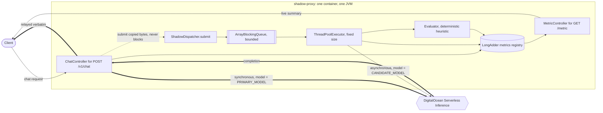

# llm-shadow-proxy

An HTTP API proxy that serves customer traffic from a **primary** LLM and returns
that response unchanged, while asynchronously mirroring the exact same request to
a **candidate** LLM in the background. The two outputs are compared with a
deterministic heuristic — both must parse as JSON, and their `action` fields must
match exactly — and the running comparison is exposed live on `GET /metric`. The
shadow path is strictly best-effort and structurally isolated, so candidate
latency, candidate failures, and traffic bursts can never delay the customer's
response or grow the heap without bound.

## Status

The Objective's first implementation is complete: the synchronous primary proxy,
bounded asynchronous candidate path, deterministic evaluator, live metrics
endpoint, and GitHub CI/release workflows are implemented and tested. See
[Limitations and what is not in v1](#limitations-and-what-is-not-in-v1) for the
features deliberately deferred.

## How it works

A request arrives at `POST /v1/chat`. The controller reads the body once into a
`byte[]`, forwards it to the primary model on DigitalOcean Serverless Inference
with the `model` field overridden by `PRIMARY_MODEL`, and relays the upstream
status and body back to the caller verbatim — errors included, because the proxy
is transparent rather than opinionated.

Once the primary response is in hand, an immutable `ShadowJob` carrying only
copied bytes is handed to `ShadowDispatcher.submit(...)` and the response is
returned. That call either admits the job onto a bounded queue instantly or sheds
it; it never blocks, never throws, and carries no reference to the servlet
request. The isolation guarantee rests on that signature rather than on ordering:
there is nothing in `submit` for the customer's response to wait on, because it
cannot call the candidate, cannot wait for queue capacity, and cannot fail. A
fixed pool of worker threads later dequeues the job, calls the candidate model,
runs the deterministic evaluator, and folds the outcome into in-process counters.
If the primary call failed, no shadow job is submitted at all — there is nothing
to compare against.



The heavy edges are the customer's critical path and the dotted edge is the
isolation boundary — the only point at which the synchronous and asynchronous
worlds meet, crossed in one direction, without blocking.

The full diagram set, including the request lifecycle and the admission and
load-shedding pipeline, is in [docs/architecture.md](docs/architecture.md). The
reasoning behind every decision is in [docs/plan/](docs/plan/).

## Requirements

- **JDK 21** (LTS). The service targets Java 21 and Spring Boot 4.1.
- **Gradle is not required.** The Gradle Wrapper (`./gradlew`) bootstraps a
  pinned, checksum-verified distribution, so a clone builds with nothing but a
  JDK installed.
- **curl** for the walkthrough below; **jq** is optional but makes metrics easier
  to inspect.

## Setup

### 1. Obtain a DigitalOcean Serverless Inference key

The upstream is DigitalOcean Serverless Inference at
`https://inference.do-ai.run`, whose `POST /v1/chat/completions` endpoint is
OpenAI-compatible and authenticated with `Authorization: Bearer`. Create a model
access key that can call both configured models and export it as
`DO_INFERENCE_API_KEY`.

The application uses that credential only for outbound DigitalOcean requests; an
`Authorization` header received from a caller is never forwarded upstream.
Supply the key from a secret manager in deployment rather than baking it into an
image or source file.

### 2. Configure

Every setting is an environment variable bound to a validated
`@ConfigurationProperties` record and checked at startup; the application refuses
to boot on invalid input rather than failing per request. Defaults are taken from
[docs/plan/04-operations.md](docs/plan/04-operations.md#configuration), where the
concurrency constants are also derived from the upstream rate limit by Little's
law rather than chosen.

| Variable | Default | Purpose |
| --- | --- | --- |
| `DO_INFERENCE_API_KEY` | **required** | Bearer token for DigitalOcean Serverless Inference |
| `PRIMARY_MODEL` | **required** | Model serving customer traffic, e.g. `llama3.3-70b-instruct` |
| `CANDIDATE_MODEL` | **required** | Model under evaluation |
| `DO_INFERENCE_BASE_URL` | `https://inference.do-ai.run` | Upstream base URL; pointed at WireMock locally |
| `SERVER_PORT` | `8080` | Bind port |
| `MANAGEMENT_SERVER_PORT` | `9090` | Actuator health port, not published externally |
| `MAX_CONCURRENT_REQUESTS` | `128` | In-flight inbound request cap; beyond it the service returns `503` |
| `CONNECT_TIMEOUT` | `2s` | Connect timeout for both upstream pools |
| `PRIMARY_TIMEOUT` | `30s` | Read timeout on the customer path |
| `SHADOW_TIMEOUT` | `20s` | Read timeout for a candidate call |
| `SHADOW_QUEUE_SIZE` | `32` | `ArrayBlockingQueue` capacity; full queues shed without blocking |
| `SHADOW_WORKERS` | `32` | Fixed pool size; the cap on concurrent candidate calls |
| `SHADOW_BUDGET_BYTES` | `8388608` | Byte ceiling on admitted-but-unfinished work; the byte gate |
| `SHADOW_TASK_TTL` | `30s` | Jobs older than this are dropped at dequeue; the lifetime gate |
| `SHADOW_SAMPLE_RATE` | `1.0` | Independent probability that an eligible request enters the shadow path |
| `MAX_REQUEST_BYTES` | `131072` | Inbound body cap; exceeding it returns `413` |
| `MAX_RESPONSE_BYTES` | `262144` | Cap on bytes read from an upstream response |
| `MAX_EVAL_CONTENT_BYTES` | `32768` | Assistant content retained for comparison |
| `SHUTDOWN_GRACE` | `15s` | Grace for in-flight primary requests; the shadow queue is discarded |
| `ALLOW_AA_MODE` | `false` | Permits `PRIMARY_MODEL == CANDIDATE_MODEL`, which otherwise refuses to boot |
| `LOG_LEVEL` | `info` | Request and response bodies are never logged at this level |

### 3. Run

```bash
export DO_INFERENCE_API_KEY=...
export PRIMARY_MODEL=llama3.3-70b-instruct
export CANDIDATE_MODEL=openai-gpt-oss-120b

./gradlew bootRun
```

The main API listens on `http://localhost:8080`. Health probes are separate:

```bash
curl -s http://localhost:9090/actuator/health
```

## Step-by-step usage and metrics

`GET /metric` is read-only. Metrics change when `POST /v1/chat` processes work;
there is intentionally no endpoint that edits counters directly. Counters are
local to this process and reset when it restarts.

### 1. Read the baseline

```bash
curl -s http://localhost:8080/metric | jq '{
  total_requests,
  shadow,
  evaluation
}'
```

Immediately after startup, counters are zero and live gauges show the configured
queue, worker, and byte-budget limits.

### 2. Send one customer request

The `model` field is optional and ignored. The service always uses
`PRIMARY_MODEL` for the synchronous call and `CANDIDATE_MODEL` for the
asynchronous copy.

```bash
curl -s http://localhost:8080/v1/chat \
  -H 'Content-Type: application/json' \
  -d '{
    "messages": [
      {"role": "system", "content": "Reply only with JSON: {\"action\":\"...\"}"},
      {"role": "user", "content": "The user wants to cancel their order."}
    ],
    "temperature": 0,
    "max_completion_tokens": 256
  }'
```

The upstream response is relayed verbatim. Nothing about the shadow evaluation
appears in it — no extra fields, no extra headers, no candidate latency.

### 3. Wait for the asynchronous result

The primary response can arrive before the candidate finishes. Poll `completed`
rather than sleeping for a guessed duration:

```bash
until [ "$(curl -s http://localhost:8080/metric | jq '.shadow.completed')" -ge 1 ]; do
  sleep 0.2
done
```

### 4. Inspect what changed

```bash
curl -s http://localhost:8080/metric | jq '{
  total_requests,
  shadow: {
    eligible: .shadow.eligible,
    enqueued: .shadow.enqueued,
    coverage_pct: .shadow.coverage_pct,
    shed_total: .shadow.shed_total,
    completed: .shadow.completed,
    errors: .shadow.errors,
    timeouts: .shadow.timeouts,
    queue_depth: .shadow.queue_depth,
    bytes_used: .shadow.bytes_used
  },
  evaluation
}'
```

For a successful primary request, `total_requests` and `shadow.eligible` increase
immediately. `shadow.enqueued` increases if the job fits the sampling, queue, and
byte gates. Later, `shadow.completed` and an evaluation verdict increase. A
candidate timeout or transport failure increments `timeouts` or `errors` instead
of an evaluation verdict.

`exact_match_rate` uses only exact matches and mismatches as its denominator.
Malformed or unusable model output is reported separately under
`primary_unusable`, `candidate_unusable`, `both_unusable`, and
`unusable_by_reason`. The Wilson interval communicates sample uncertainty.

### 5. Drive several samples

```bash
for n in $(seq 1 10); do
  curl -s http://localhost:8080/v1/chat \
    -H 'Content-Type: application/json' \
    -d "{
      \"messages\": [
        {\"role\":\"system\",\"content\":\"Reply only with JSON: {\\\"action\\\":\\\"...\\\"}\"},
        {\"role\":\"user\",\"content\":\"Sample request $n: cancel the order\"}
      ],
      \"temperature\": 0,
      \"max_completion_tokens\": 128
    }" >/dev/null
done

curl -s http://localhost:8080/metric | jq
```

Because shadow execution is asynchronous, `eligible` may briefly be greater than
the number of terminal outcomes. Re-read after the workers drain.

## How this bounds the memory footprint

This section is required by [docs/Objective.md](docs/Objective.md), and it is the
part of the design worth reading closely. The claim is specific: **peak retained
state is a product of configured constants, not of traffic.** No amount of
inbound load changes the ceiling; it only changes how much work is discarded to
stay under it.

Several independent limits combine to make that true.

**The shadow queue is bounded twice.** `SHADOW_QUEUE_SIZE` is the capacity of an
`ArrayBlockingQueue` allocated once at startup, so at most that many jobs wait in
the queue — notably *not* the unbounded `LinkedBlockingQueue` that
`Executors.newFixedThreadPool` would have supplied, which would let a backlog
grow until `OutOfMemoryError`. A count gate alone still permits a large swing in
footprint depending on payload size, so a second gate bounds the actual bytes:
`SHADOW_BUDGET_BYTES` is an `AtomicLong` reserved with a **compare-and-set loop**,
so the budget is never exceeded even transiently. The reservation is taken at
admission and released in a `finally` block only when the task finishes, which is
why one term covers queued and in-flight work alike.

**Submission never blocks; it sheds.** The `RejectedExecutionHandler` is
deliberately neither `CallerRunsPolicy` — which would run the candidate call on
the request thread and hand the customer the candidate's latency — nor
`AbortPolicy`, which would make shedding an exception on the request path.
Shedding is a normal outcome, so it increments a counter and returns.
Backpressure is absorbed by dropping work rather than by parking request threads
that each keep a request body reachable.

**Sampling happens before allocation.** When `SHADOW_SAMPLE_RATE` is below `1.0`,
an independent random draw rejects work before reserving bytes or touching the
queue. At the default `1.0`, every eligible request is attempted; overload is
then shed by the byte-budget or queue-capacity gates. Adaptive admission is not
implemented in this version.

**Worker concurrency is fixed.** `SHADOW_WORKERS` platform threads, pre-sized and
never growing, cap the number of concurrent candidate calls, candidate
connections, and in-flight response buffers regardless of arrival rate. A fixed
pool rather than a virtual thread per request is precisely what makes this a
bound.

**A task TTL closes the unbounded-lifetime leak.** A bounded queue with unbounded
item *lifetime* still leaks, because a handful of slow tasks pin their
reservations indefinitely. `SHADOW_TASK_TTL` is checked at dequeue, before the
candidate is called, and stale jobs are dropped as `stale_in_queue` rather than
spending upstream quota on a sample that is no longer current. This is the leak
vector most often forgotten, and it is sufficient on its own to turn a "bounded"
queue into an unbounded one.

**Inbound concurrency is capped separately.** Bounding the shadow path is
necessary but not sufficient. Virtual threads impose no limit of their own, so a
slow primary would let arriving requests accumulate without limit, each holding a
body: the shadow subsystem would stay inside its ceiling while the process died
anyway. A semaphore filter caps in-flight requests at `MAX_CONCURRENT_REQUESTS`
and returns `503` with `Retry-After` immediately beyond it.

### The formula

```
reservation_i     =  len(requestBody) + len(primaryContent) + overhead
                  <= MAX_REQUEST_BYTES + MAX_RESPONSE_BYTES + 512 B

invariant (CAS)   :  sum(reservation_i) <= SHADOW_BUDGET_BYTES
                     over every admitted-but-not-yet-completed job

admitted jobs     <= SHADOW_QUEUE_SIZE + SHADOW_WORKERS

bounded state     <= MAX_CONCURRENT_REQUESTS x (MAX_REQUEST_BYTES + MAX_RESPONSE_BYTES)
                   + min(
                       SHADOW_BUDGET_BYTES,
                       admitted jobs x reservation_i
                     )
                   + SHADOW_WORKERS x (MAX_RESPONSE_BYTES + per-thread overhead)
```

At the documented defaults:

```
inbound primary buffers : 128 x (128 KiB + 256 KiB) = 48 MiB
retained shadow jobs    : SHADOW_BUDGET_BYTES       =  8 MiB
candidate responses     :  32 x 256 KiB             =  8 MiB
                                                        ------
application-controlled state                         ~= 64 MiB
```

Every term is a configured constant. There is no traffic-dependent term anywhere
in it.

### The honest caveat

Application-controlled state is bounded at roughly **64 MiB**, but on the JVM the
**baseline footprint dominates the total**: heap reserve, metaspace, code cache,
thread stacks, and GC structures are typically **150–250 MB** before the
application stores a single byte. The formula above genuinely bounds the part of
memory this design controls — the part that could otherwise grow without limit —
but it does not make the container small, and it is not the sizing input.

**Container sizing:** set the memory limit to **768 MB** with
`-XX:MaxRAMPercentage=70`, letting the JVM size its heap from the container limit
rather than hard-coding `-Xmx`. Treat the bounded terms as the guarantee that load
cannot push you past that limit, not as the number you size to. Derivation in
[docs/plan/06-production-readiness.md](docs/plan/06-production-readiness.md#capacity-and-deployment).

## Testing

```bash
./gradlew test
./gradlew clean check bootJar
```

Unit and integration tests cover the evaluator's rules, the byte-budget invariant
under concurrent admission, non-blocking queue shedding, primary response
fidelity, asynchronous candidate routing, inbound size/concurrency limits, and
metrics reconciliation and serialization.

## Project layout

```
.
├── gradlew, gradle/            pinned Gradle Wrapper
├── build.gradle.kts, settings.gradle.kts
├── src/main/java/com/example/shadowproxy/
│   ├── config/                 validated properties, RestClient beans, bounded executor
│   ├── inference/              DigitalOcean Serverless Inference client
│   ├── proxy/                  ChatController and the exception handler
│   ├── shadow/                 ShadowJob, ShadowDispatcher, ShadowTask
│   ├── eval/                   deterministic evaluator, pure and stateless
│   ├── metrics/                LongAdder registry, snapshot, MetricController
│   └── web/                    concurrency cap, request id, request size limit filters
├── src/test/java/...           unit and integration tests
├── docs/                       Objective, architecture diagrams, plan
├── .github/workflows/          CI and tagged release pipelines
└── README.md
```

## Limitations and what is not in v1

- **No inbound authentication.** The service ships with no client authentication
  and no per-key rate limiting on either route. Anyone who can reach the port can
  spend the inference budget through `POST /v1/chat` and read volume, error rates,
  and candidate match quality from `GET /metric`. **Until authentication ships,
  the service must not be exposed to an untrusted network** — put it behind a
  gateway or a private network boundary. The deferred design and the full argument
  are in
  [docs/plan/06-production-readiness.md](docs/plan/06-production-readiness.md#deferred-inbound-authentication-and-rate-limiting).
  Note that `MAX_CONCURRENT_REQUESTS` and its `503` are an inbound memory bound,
  not an access control, and should not be mistaken for one.
- **Streaming is rejected.** `"stream": true` returns `400`. Shadow comparison
  requires a complete JSON body from both models; supporting streaming would mean
  buffering and re-emitting full responses, which is out of scope for v1. See
  [docs/plan/02-api-contract.md](docs/plan/02-api-contract.md#status-codes).
- **Metrics are per-replica and reset on restart.** Counters are in-process
  `LongAdder` values, so `/metric` reports one replica's view — `scope` and
  `replica_id` say so in the payload — and history does not survive a restart.
  The Objective asks for a real-time summary, not durable history; fleet
  aggregation requires an external collector.
- **No persistence of mismatched payloads and no runtime `PUT /config`.** Both
  are listed under "Next" in [docs/Objective.md](docs/Objective.md) rather than in
  v1 scope.
- **Evaluation is deterministic, not semantic.** The heuristic compares one string
  field. It answers "does the candidate choose the same action" and nothing about
  response quality.
- **Adaptive admission, a candidate circuit breaker, and the A/A control arm are
  not implemented yet.** This version uses the static `SHADOW_SAMPLE_RATE`, then
  sheds at the byte and queue gates. The related plan sections describe future
  hardening, not current runtime behavior.

## Documentation

- [docs/Objective.md](docs/Objective.md) — the frozen specification. Do not edit.
- [docs/architecture.md](docs/architecture.md) — the architecture flow diagrams:
  system context, component map, request lifecycle, admission and load shedding.

**Build instructions**, one per component, plus the contract they share:

- [docs/implementation-contracts.md](docs/implementation-contracts.md) — the frozen cross-component types, the config surface, and the build order.
- [docs/implementation-api-proxy.md](docs/implementation-api-proxy.md) — `POST /v1/chat`, the upstream client, the servlet filters.
- [docs/implementation-eval-shadow.md](docs/implementation-eval-shadow.md) — admission, the bounded executor, the candidate call, the evaluator.

**Design reasoning**, kept as the record of how the above was arrived at:

- [docs/plan/README.md](docs/plan/README.md) — index, locked-in decisions, non-goals.
- [docs/plan/01-architecture.md](docs/plan/01-architecture.md) — components, concurrency, the memory model.
- [docs/plan/02-api-contract.md](docs/plan/02-api-contract.md) — endpoint contracts, payloads, evaluation rules.
- [docs/plan/03-implementation-plan.md](docs/plan/03-implementation-plan.md) — phased build plan and milestones.
- [docs/plan/04-operations.md](docs/plan/04-operations.md) — configuration, CI/CD, deployment, observability, runbook.
- [docs/plan/05-service-topology.md](docs/plan/05-service-topology.md) — one service vs three, frozen contracts, Docker topology.
- [docs/plan/06-production-readiness.md](docs/plan/06-production-readiness.md) — security, resilience, SLOs, supply chain, go-live checklist.
- [docs/plan/07-design-review.md](docs/plan/07-design-review.md) — independent review, what was adopted and what was rejected.
