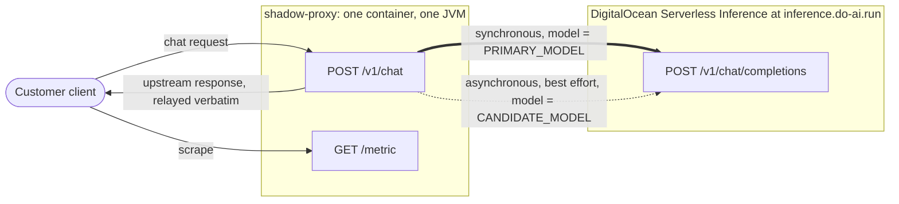
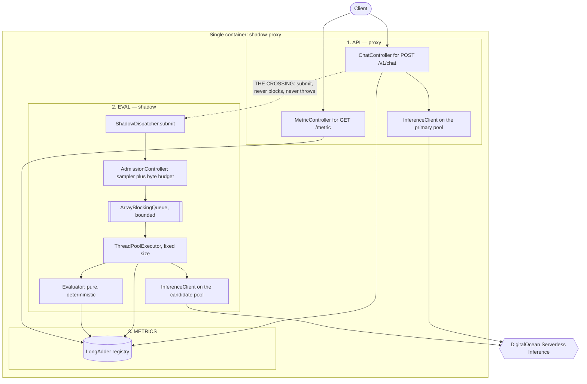
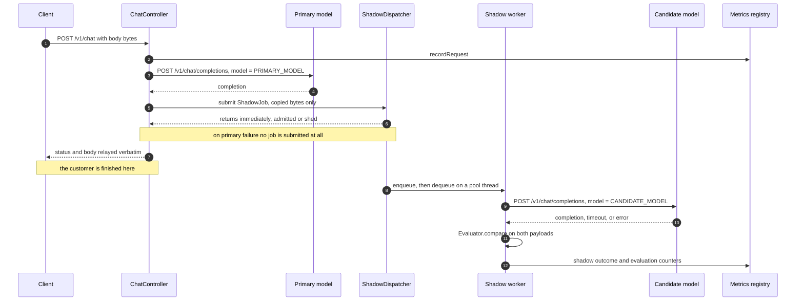
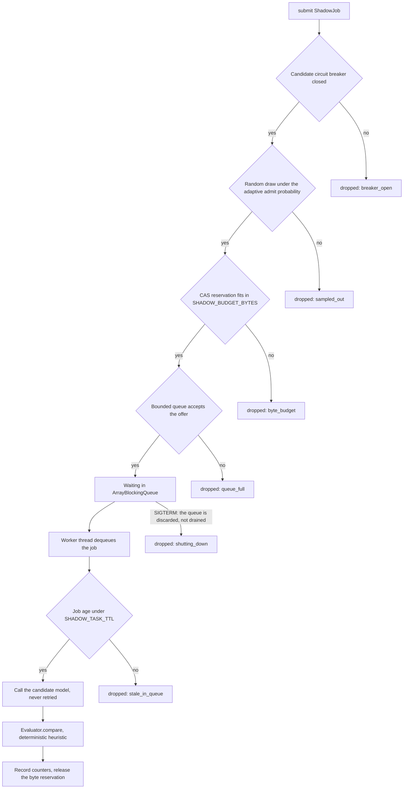

# Architecture Flow Diagram

This is the artifact named in the "TO build" section of
[Objective.md](Objective.md): a diagram mapping the API layer, the synchronous
immediate path, and the decoupled background shadow evaluation poll. The
diagrams are the deliverable; the prose makes them legible, and the reasoning
behind each decision lives in the linked plan documents.

---

## 1. System context

The service is a transparent proxy in front of exactly one external dependency.
The "candidate model" is not something we host, run, or scale: it is the *same*
DigitalOcean Serverless Inference endpoint called with a different value in the
`model` field. That is the most important thing to understand here, because it
is why the shadow target needs no isolation work of its own — it is already a
separate service on separate infrastructure, operated by someone else.



The heavy edge is the customer's critical path; the dotted edge is work done
after the customer has already been served. Both terminate at the same
OpenAI-compatible endpoint with the same request shape, differing only in the
`model` field and in their read timeouts and connection pools. See
[02-api-contract.md](plan/02-api-contract.md) for the upstream contract and
[05-service-topology.md](plan/05-service-topology.md) for why an external shadow
target removes the usual argument for splitting this into three services.

---

## 2. Internal component map

Three components with frozen contracts, compiled into one image. The dependency
rule is one-directional and acyclic: **API depends on EVAL and METRICS, EVAL
depends on METRICS, METRICS depends on nothing.** EVAL never calls back into API.



The dotted edge is the entire surface between the synchronous and asynchronous
worlds. It is one method, `ShadowDispatcher.submit(ShadowJob)`, which either
accepts the job onto the bounded queue instantly or sheds it. It does not wait,
does not throw, and carries nothing but an immutable record. Everything else
inside EVAL is unreachable from the API layer.

That isolation is structural rather than reviewed: `ShadowJob` has no field able
to hold a servlet type, and an ArchUnit test fails the build if anything under
`shadow` or `eval` imports `jakarta.servlet` or `org.springframework.web`. See
[01-architecture.md](plan/01-architecture.md#api-layer) and the frozen
interfaces in [05-service-topology.md](plan/05-service-topology.md#frozen-contracts).

---

## 3. Request lifecycle

This diagram is what proves the Objective's hardest requirement — that candidate
latency, errors, and failures "must never delay or impact primary response."



Two properties are visible here and nowhere else.

**The customer never waits on the candidate, and the reason is structural rather
than an accident of ordering.** Steps 5 and 6 sit between the primary completion
and the write to the client, so it is fair to ask what they cost. The answer is
that `submit` is non-blocking, allocation-light, and total: it takes the job,
either admits it or sheds it, and returns. It cannot call the candidate, cannot
wait on queue capacity, and cannot throw. There is nothing in it for the response
to wait for, so candidate latency, candidate errors, and a saturated queue are all
invisible from step 7.

Handing the job off here rather than after the socket write is deliberate. A
controller returns a `ResponseEntity` and the framework writes it afterwards, so
"submit after the write" would need a `ResponseBodyAdvice` or a filter wrapper —
machinery whose only purpose is to make the ordering argument easier to state.
It is also worse: enqueue time would then depend on client network speed, so a
slow or distant client pushes its job toward the TTL and gets quietly
under-sampled, biasing the very sample this service exists to measure.

**The hand-off carries copied bytes.** Once the response is committed at step 7,
the `HttpServletRequest`, its `InputStream`, request-scoped beans, and
`RequestContextHolder` are all invalid, so a worker touching them fails
intermittently and confusingly. That is the most likely bug in this design, which
is why `ShadowJob` is a copy taken at submit time and has no field able to hold a
servlet type.

---

## 4. Shadow admission and load shedding

The Objective requires that "in heavy burst traffic, shadow queue should shed
load and drop background evals to prevent memory leak." A job passes through
gates in a fixed order, and every drop is attributed to a specific reason,
because "we are deliberately sampling" and "we are overloaded" demand opposite
responses from an operator.



Three things about this pipeline are deliberate and non-obvious.

**Admission is uniform random, not tail-drop.** A queue that drops whatever
arrives once it is full admits the beginning of every burst and rejects the
tail. Bursts are not random samples of production traffic, so the surviving
sample is skewed and `exact_match_rate` becomes a biased estimator of the one
number this service exists to report — invisibly, because the figure still looks
precise. The admit probability is instead recomputed once a second as
`min(1, sustainable_drain_rate / ewma(arrival_rate))` and floored so measurement
never stops entirely
([reasoning](plan/01-architecture.md#load-shedding-and-why-it-is-not-just-drop-when-full)).

**The three hard gates each close a different leak.** The count gate bounds how
many jobs are retained, the byte-budget gate bounds how many bytes those jobs
occupy — count alone permits a large swing in footprint depending on payload
size — and the TTL bounds item *lifetime*, since a few slow tasks pinning their
reservations indefinitely turn a "bounded" queue into a leak on their own.

**The rejection handler is not `CallerRunsPolicy`.** That default would run the
candidate call on the request thread and hand the customer the candidate's
latency, defeating the whole design. Nor is it `AbortPolicy`, which would make
shedding an exception in the request path; shedding is a normal outcome, so it
increments a counter and returns.

---

## 5. Reading the diagrams

All four diagrams encode a single invariant, and every decision in this service
follows from it:

> The synchronous and asynchronous paths meet at **exactly one point**, in
> **exactly one direction**, **without blocking**, and **without passing any
> reference to the servlet request.**

Each clause is load-bearing:

- **One point.** `ShadowDispatcher.submit` is the only edge from API to EVAL, so
  the guarantee is verified by reading one signature rather than tracing call
  paths. It is also the seam that would let EVAL be extracted into its own
  service later without touching controller, evaluator, or metric code.
- **One direction.** EVAL never calls back into API, and METRICS calls nothing.
  The write side (`MetricsRecorder`) and read side (`MetricsReader`) are separate
  interfaces so the compiler enforces the direction, not a reviewer.
- **Without blocking.** Submission either succeeds instantly or sheds. Nothing on
  the request path waits on queue capacity, a worker, or the candidate model.
- **Without a request reference.** `ShadowJob` carries copied bytes and an id,
  never a servlet object, so background work cannot touch state that goes invalid
  the moment the response is committed.

Violate any one of these and "shadow never delays primary" stops being a
structural property and becomes a hope.

---

## 6. The bounded constants

Every term in the memory footprint is a product of configured constants rather
than of traffic. Defaults are in
[04-operations.md](plan/04-operations.md#configuration), and their derivation
from the upstream rate limit is
[here](plan/04-operations.md#deriving-the-concurrency-constants).

| Constant | Default | What it bounds |
| --- | --- | --- |
| `MAX_CONCURRENT_REQUESTS` | `128` | In-flight inbound requests; beyond it the service returns `503` immediately rather than accumulating request state |
| `MAX_REQUEST_BYTES` | `131072` | Any single inbound body, and therefore the request half of a job's byte reservation |
| `MAX_RESPONSE_BYTES` | `262144` | Bytes read from an upstream response, so one oversized reply cannot inflate the heap |
| `MAX_EVAL_CONTENT_BYTES` | `32768` | Assistant content retained for comparison; an `action` payload is well under 1 KiB |
| `SHADOW_QUEUE_SIZE` | `32` | Admitted-but-unstarted shadow jobs; the count gate. Equal to `SHADOW_WORKERS`, and kept under `drain_rate x SHADOW_TASK_TTL` so an admitted job can still be processed before it expires |
| `SHADOW_WORKERS` | `32` | Concurrent candidate calls, candidate connections, and in-flight response buffers |
| `SHADOW_BUDGET_BYTES` | `8388608` | Bytes held by admitted-but-unfinished jobs, queued and in-flight alike; the byte gate |
| `SHADOW_TASK_TTL` | `30s` | How long a job may live before it is dropped at dequeue; the lifetime gate |
| `SHADOW_SAMPLE_RATE` | `1.0` | Operator ceiling on eligibility, distinct from the adaptive probability below it |
| `SHADOW_TIMEOUT` | `20s` | How long a worker waits on the candidate before recording a timeout |
| `PRIMARY_TIMEOUT` | `30s` | How long the customer path waits on the primary before returning `504` |
| `CANDIDATE_QUOTA_SHARE` | `0.4` | Share of upstream request quota the shadow path may consume; the primary is never throttled |
| `SHUTDOWN_GRACE` | `15s` | How long in-flight primary requests get on `SIGTERM` |

Peak retained shadow state follows directly from three of them:

```
reservation_i    =  len(requestBody) + len(primaryContent) + overhead
invariant (CAS)  :  sum(reservation_i) <= SHADOW_BUDGET_BYTES
peak shadow heap ~= SHADOW_BUDGET_BYTES
                  + SHADOW_WORKERS x (MAX_RESPONSE_BYTES + per-thread overhead)
```

One caveat worth repeating: this bounds the memory *this design controls*. JVM
baseline footprint — heap reserve, metaspace, code cache, thread stacks, GC
structures — is typically 150–250 MB and dominates the total, so size the
container from
[06-production-readiness.md](plan/06-production-readiness.md#capacity-and-deployment),
not from the formula alone.

---

## 7. Building it

Each of the three components in section 2 has its own implementation plan, over
a shared contract that fixes the types crossing between them:

- [implementation-contracts.md](implementation-contracts.md) — the frozen types, the config surface, and the order to build in
- [implementation-api-proxy.md](implementation-api-proxy.md) — the API layer of section 2
- [implementation-eval-shadow.md](implementation-eval-shadow.md) — the shadow pipeline of sections 3 and 4
- [implementation-metrics.md](implementation-metrics.md) — the registry every arrow in section 2 terminates at
