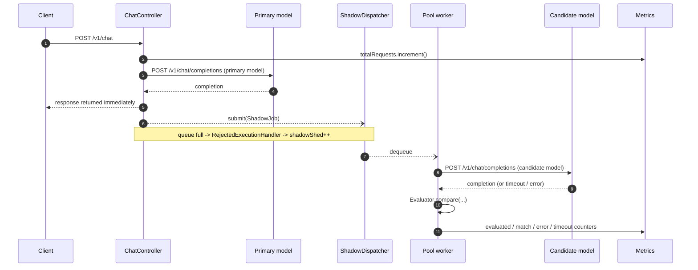

# Architecture

## Design goal

One rule drives every decision below: **the customer's request path must be
completely unaware that shadow evaluation exists.** Everything related to the
candidate model lives behind a non-blocking hand-off, so its latency, failures,
and backlog cannot propagate into the response the customer is waiting on.

## Component map


The dotted edge is the isolation boundary. `Dispatcher.submit(...)` either
accepts the job onto the bounded queue instantly or sheds it; it never waits.

## Request lifecycle



Steps 5 and 6 complete before step 7 is even attempted, which is what guarantees
the shadow path cannot add latency.

## Components

### API layer

Two Spring MVC endpoints:

- `POST /v1/chat` — the customer-facing proxy (`ChatController`).
- `GET /metric` — the live summary (`MetricController`).

`spring.threads.virtual.enabled=true` puts request handling on virtual threads,
so a servlet thread is never blocked while the primary model is thinking. The
controller reads the request body once into a `byte[]`, uses it for the primary
call, and reuses the same array for the shadow job.

That `byte[]` copy matters for a Java-specific reason: once the response is
committed, the `HttpServletRequest`, its `InputStream`, request-scoped beans, and
`RequestContextHolder` are all invalid. A background worker must never touch
them. Anything the shadow path needs — body bytes, request id, primary output —
is copied into an immutable `ShadowJob` record at submit time. This is the Java
equivalent of detaching the background work from the request context, and it is
the single most likely place to introduce a subtle bug.

Rather than rely on review to catch that, the isolation is made **structurally
unrepresentable**: `ShadowJob` has no field capable of referencing the request,
`ShadowDispatcher.submit` takes no servlet type, and an ArchUnit test fails the
build if anything under `shadow` or `eval` imports `jakarta.servlet` or
`org.springframework.web`. A reviewer can then verify the guarantee by reading a
record definition instead of tracing call paths.

### Primary path

`InferenceClient` wraps a Spring `RestClient` pointed at
`POST https://inference.do-ai.run/v1/chat/completions`, injecting the
`Authorization: Bearer` header and overriding the `model` field with the
configured primary model. Two client beans exist — primary and candidate — each
with its own read timeout **and its own connection pool**. Separate pools are
not an optimisation: a shared pool would let shadow workers hold connections the
customer path needs, breaking the isolation guarantee through a channel that
queue bounding cannot catch. Sizing and timeouts are specified in
[06-production-readiness.md](06-production-readiness.md#separate-connection-pools).

The upstream status code and body are relayed to the caller verbatim, including
errors: the proxy is transparent, not opinionated. Spring's default 4xx/5xx
exception behaviour is disabled so error bodies pass through untouched.

### Shadow dispatcher (the load-shed boundary)

The executor is constructed explicitly rather than via `Executors`, because the
defaults are exactly wrong for this use case:

```java
new ThreadPoolExecutor(
    workers, workers,                       // fixed pool: no elastic growth
    0L, TimeUnit.MILLISECONDS,
    new ArrayBlockingQueue<>(queueSize),    // bounded: the memory ceiling
    new ShadowThreadFactory(),              // named, daemon threads
    (job, executor) -> metrics.recordShed(QUEUE_FULL));  // shed, do not block
```

The `RejectedExecutionHandler` is deliberately not `CallerRunsPolicy` — that
would run the candidate call *on the request thread* and hand the customer the
candidate's latency, defeating the entire design. It is also not `AbortPolicy`,
which would make shedding an exception in the request path; shedding is a normal
outcome, so it bumps a counter and returns.

That handler is the last line of defence, not the policy. The policy is below.

### Load shedding, and why it is not just "drop when full"

The obvious design is a bounded queue that drops whatever arrives once it is
full. That satisfies the Objective's wording. It also **quietly biases the one
number this service exists to produce.**

A FIFO that drops on overflow admits jobs from the *beginning* of each burst and
rejects the *tail*. Bursts are not random samples of production traffic — they
line up with peak hours, retry storms, and individual heavy customers. So the
surviving sample is systematically skewed toward whatever kind of request starts
a burst, and `exact_match_rate` computed over it is a biased estimator of the
true match rate. The failure is invisible: the number still looks precise, and
nothing in the metrics hints that it is wrong.

So admission is **uniform random** instead:

```
p_admit = min(1, sustainable_drain_rate / ewma(arrival_rate))
```

recomputed once a second and floored at 1% so measurement never stops entirely.
Under a 50x burst roughly 98% of shadow jobs are dropped, but dropped *at
random*, so the surviving sample stays representative and the match rate remains
a valid estimator of the true rate.

Three hard gates sit behind the sampler, each closing a different leak:

1. **Count gate** — `SHADOW_QUEUE_SIZE`, the `ArrayBlockingQueue` capacity.
   Bounds the number of retained jobs.
2. **Byte-budget gate** — `SHADOW_BUDGET_BYTES`, an `AtomicLong` reserved with a
   compare-and-set loop so the budget is never exceeded even transiently.
   The count gate alone permits a large swing in footprint depending on payload
   size; this gate bounds the actual bytes.
3. **Task TTL** — `SHADOW_TASK_TTL`. Checked at dequeue, before the candidate is
   called. A bounded queue with unbounded item *lifetime* still leaks, because a
   handful of slow tasks pin their reservations indefinitely.

The queue is deliberately **shallow**. At a sustainable drain of a couple of jobs
per second, a 256-deep queue would take minutes to drain — far longer than the
TTL — so everything past the first few dozen entries would expire unprocessed. A
deep queue is not burst absorption, it is a bias reservoir that holds memory and
throws the samples away later. Random admission absorbs burst; the queue only
smooths sub-second jitter.

Every drop is attributed to a specific cause — `sampled_out`, `queue_full`,
`byte_budget`, `breaker_open`, `stale_in_queue`, `shutting_down` — because
"deliberate cost control" and "we are overloaded" demand opposite responses from
an operator.

### Worker pool

Exactly `SHADOW_WORKERS` platform threads, pre-sized and never growing. A fixed
pool — rather than a task per request on virtual threads — is what makes
concurrency against the candidate endpoint bounded, keeps us inside upstream rate
limits, and caps the number of in-flight response buffers.

Each task is wrapped in `try/catch (Throwable)`: an exception escaping a pooled
task would otherwise be swallowed by the executor and lost, so it is caught,
counted as a shadow error, and logged once. A failure in background evaluation
must never affect the proxy.

### Deterministic evaluator

A stateless `@Component` with pure methods, implementing the heuristic from the
Objective in order:

1. Extract the assistant message content from each completion.
2. Attempt to parse each as JSON with Jackson. Invalid JSON on either side means
   no match.
3. Read the `action` field from both parsed objects.
4. Record a match only if both are present and exactly equal (plain
   `String.equals`, no normalisation, no case folding).

Full rules, including the fenced-code-block tolerance, are specified in
[02-api-contract.md](02-api-contract.md).

### Metrics registry

A singleton holding `LongAdder` fields plus a `snapshot()` returning an immutable
record. `LongAdder` rather than `AtomicLong` because the write path is many
concurrent increments from pool threads and request threads, and `LongAdder`
trades a slightly more expensive read for far less contention on write — exactly
our access pattern. Rates are computed at read time from raw counters, so stored
state is a small fixed-size object regardless of traffic volume.

## Failure isolation matrix

- **Candidate is slow** — the worker blocks up to the candidate read timeout,
  then gives up and increments `shadow_timeouts`. Primary path untouched.
- **Candidate returns 5xx or a malformed body** — `shadow_errors` increments; the
  request is not counted as evaluated.
- **Candidate is down entirely** — all workers hit timeouts, the queue fills, and
  excess jobs shed. Throughput of the primary path is unchanged.
- **Traffic burst** — queue saturates, `shadow_shed` climbs, heap stays flat.
- **Primary fails** — the upstream error is relayed verbatim. No shadow job is
  submitted for a failed primary, since there is nothing to compare against.
- **Exception in a worker** — caught per task, counted as a shadow error, the
  worker thread survives and keeps draining the queue.

## How this bounds the memory footprint

This is the section the Objective explicitly asks the README to carry; the
reasoning lives here and the README summarises it.

Peak retained shadow state is a product of configured constants, not of traffic.
The byte budget makes it an explicit ceiling rather than an inference from the
job count:

```
reservation_i     =  len(requestBody) + len(primaryContent) + overhead
                  <= MAX_REQUEST_BYTES + MAX_EVAL_CONTENT_BYTES + 512 B

invariant (CAS)   :  sum(reservation_i) <= SHADOW_BUDGET_BYTES
                     over every admitted-but-not-yet-completed job

peak shadow heap  ~=  SHADOW_BUDGET_BYTES
                    + SHADOW_WORKERS x (MAX_RESPONSE_BYTES + per-thread overhead)
```

A reservation is taken at admission and released only when the task finishes, so
it covers queued *and* in-flight work in one term. The three leak vectors of an
in-process queue are each closed by a named constant: unbounded queue growth by
the count and byte gates, unbounded item size by `MAX_REQUEST_BYTES` and
`MAX_RESPONSE_BYTES`, and unbounded item lifetime by `SHADOW_TASK_TTL` plus the
per-task timeout. The third is the one usually forgotten, and it is sufficient on
its own to turn a "bounded" queue into a leak.

Bounding the shadow path is necessary but not sufficient. Inbound concurrency is
capped separately at `MAX_CONCURRENT_REQUESTS`, because virtual threads impose no
limit of their own and a slow primary would otherwise accumulate request state
without bound — the shadow subsystem would stay inside its ceiling while the
process died anyway. The complete bound is in
[06-production-readiness.md](06-production-readiness.md#bounded-inbound-concurrency).

Three properties combine to make that a real ceiling:

1. **The queue is bounded.** `ArrayBlockingQueue` is allocated at a fixed
   capacity and cannot hold more than `SHADOW_QUEUE_SIZE` jobs. There is no
   unbounded collection anywhere on the shadow path — notably *not* the
   `LinkedBlockingQueue` that `Executors.newFixedThreadPool` would have given us,
   which is unbounded and would let the backlog grow until `OutOfMemoryError`.
2. **Submission never blocks.** The rejection handler sheds instead of waiting,
   so backpressure is absorbed by dropping work rather than by parking request
   threads that each keep a request body reachable.
3. **Concurrency is fixed.** `SHADOW_WORKERS` threads means at most that many
   candidate responses are buffered at once, no matter the arrival rate.

At the defaults in [04-operations.md](04-operations.md#configuration) the shadow
subsystem's ceiling is 8 MB of budgeted job data plus roughly 8 MB of in-flight
response buffers. Inbound bodies are capped by a servlet filter and candidate
responses by a bounded read, so a single oversized payload cannot inflate a
reservation. Each `ShadowJob` is a record of immutable `byte[]` references that
becomes unreachable the moment its task completes.

**An honest caveat specific to the JVM.** Application-controlled state is bounded
at roughly 65 MB, but JVM baseline footprint — heap reserve, metaspace, code
cache, thread stacks, GC structures — is typically 150–250 MB and therefore
*dominates* the total. The formula above genuinely bounds the part of memory this
design controls; it does not make the container small. Size the container from
[06-production-readiness.md](06-production-readiness.md#capacity-and-deployment)
rather than from the formula alone.

The failure mode we are explicitly designing out is the naive
`@Async` or `CompletableFuture.runAsync(...)` per request on a default executor.
Spring's default `SimpleAsyncTaskExecutor` (and the common-pool path) applies no
bound: under burst that spawns unbounded concurrent calls, each retaining a
request copy and a connection, and the JVM dies of heap exhaustion or upstream
rate limiting while the primary path degrades alongside it.
