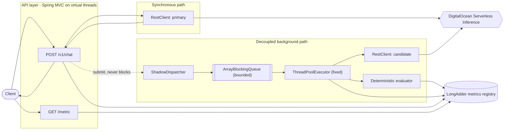
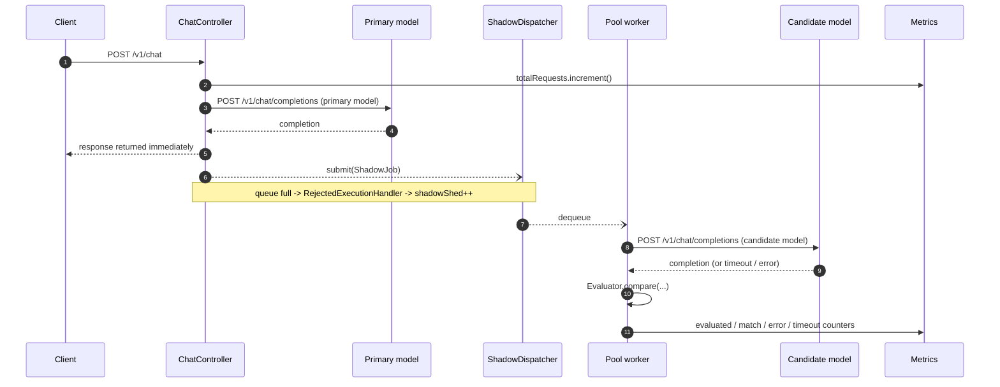

# Architecture

## Design goal

One rule drives every decision below: **the customer's request path must be
completely unaware that shadow evaluation exists.** Everything related to the
candidate model lives behind a non-blocking hand-off, so its latency, failures,
and backlog cannot propagate into the response the customer is waiting on.

## Component map



The dotted edge is the isolation boundary. `Dispatcher.submit(...)` either
accepts the job onto the bounded queue instantly or sheds it; it never waits.

## Request lifecycle



Steps 5 and 6 complete before step 7 is even attempted, which is what guarantees
the shadow path cannot add latency.

## Components

### API layer

Two Spring MVC endpoints:

- `POST /v1/chat` — the customer-facing proxy (`ChatController`).
- `GET /metric` — the live summary (`MetricController`).

`spring.threads.virtual.enabled=true` puts request handling on virtual threads,
so a servlet thread is never blocked while the primary model is thinking. The
controller reads the request body once into a `byte[]`, uses it for the primary
call, and reuses the same array for the shadow job.

That `byte[]` copy matters for a Java-specific reason: once the response is
committed, the `HttpServletRequest`, its `InputStream`, request-scoped beans, and
`RequestContextHolder` are all invalid. A background worker must never touch
them. Anything the shadow path needs — body bytes, request id, primary output —
is copied into an immutable `ShadowJob` record at submit time. This is the Java
equivalent of detaching the background work from the request context, and it is
the single most likely place to introduce a subtle bug.

### Primary path

`InferenceClient` wraps a Spring `RestClient` pointed at
`POST https://inference.do-ai.run/v1/chat/completions`, injecting the
`Authorization: Bearer` header and overriding the `model` field with the
configured primary model. Two client beans exist — primary and candidate — each
with its own read timeout **and its own connection pool**. Separate pools are
not an optimisation: a shared pool would let shadow workers hold connections the
customer path needs, breaking the isolation guarantee through a channel that
queue bounding cannot catch. Sizing and timeouts are specified in
[06-production-readiness.md](06-production-readiness.md#separate-connection-pools).

The upstream status code and body are relayed to the caller verbatim, including
errors: the proxy is transparent, not opinionated. Spring's default 4xx/5xx
exception behaviour is disabled so error bodies pass through untouched.

### Shadow dispatcher (the load-shed boundary)

The executor is constructed explicitly rather than via `Executors`, because the
defaults are exactly wrong for this use case:

```java
new ThreadPoolExecutor(
    workers, workers,                       // fixed pool: no elastic growth
    0L, TimeUnit.MILLISECONDS,
    new ArrayBlockingQueue<>(queueSize),    // bounded: the memory ceiling
    new ShadowThreadFactory(),              // named, daemon threads
    (job, executor) -> metrics.shadowShed.increment());  // shed, do not block
```

The `RejectedExecutionHandler` is the whole load-shed policy in one line. It is
deliberately not `CallerRunsPolicy` — that would run the candidate call *on the
request thread* and hand the customer the candidate's latency, defeating the
entire design. It is also not `AbortPolicy`, which would make shedding an
exception in the request path; shedding is a normal outcome, so it just bumps a
counter and returns.

Under a traffic burst the queue fills, excess jobs are dropped, and the primary
path keeps running at full speed. Shedding is reported through `GET /metric` so
the sampling gap is visible rather than silent.

### Worker pool

Exactly `SHADOW_WORKERS` platform threads, pre-sized and never growing. A fixed
pool — rather than a task per request on virtual threads — is what makes
concurrency against the candidate endpoint bounded, keeps us inside upstream rate
limits, and caps the number of in-flight response buffers.

Each task is wrapped in `try/catch (Throwable)`: an exception escaping a pooled
task would otherwise be swallowed by the executor and lost, so it is caught,
counted as a shadow error, and logged once. A failure in background evaluation
must never affect the proxy.

### Deterministic evaluator

A stateless `@Component` with pure methods, implementing the heuristic from the
Objective in order:

1. Extract the assistant message content from each completion.
2. Attempt to parse each as JSON with Jackson. Invalid JSON on either side means
   no match.
3. Read the `action` field from both parsed objects.
4. Record a match only if both are present and exactly equal (plain
   `String.equals`, no normalisation, no case folding).

Full rules, including the fenced-code-block tolerance, are specified in
[02-api-contract.md](02-api-contract.md).

### Metrics registry

A singleton holding `LongAdder` fields plus a `snapshot()` returning an immutable
record. `LongAdder` rather than `AtomicLong` because the write path is many
concurrent increments from pool threads and request threads, and `LongAdder`
trades a slightly more expensive read for far less contention on write — exactly
our access pattern. Rates are computed at read time from raw counters, so stored
state is a small fixed-size object regardless of traffic volume.

## Failure isolation matrix

- **Candidate is slow** — the worker blocks up to the candidate read timeout,
  then gives up and increments `shadow_timeouts`. Primary path untouched.
- **Candidate returns 5xx or a malformed body** — `shadow_errors` increments; the
  request is not counted as evaluated.
- **Candidate is down entirely** — all workers hit timeouts, the queue fills, and
  excess jobs shed. Throughput of the primary path is unchanged.
- **Traffic burst** — queue saturates, `shadow_shed` climbs, heap stays flat.
- **Primary fails** — the upstream error is relayed verbatim. No shadow job is
  submitted for a failed primary, since there is nothing to compare against.
- **Exception in a worker** — caught per task, counted as a shadow error, the
  worker thread survives and keeps draining the queue.

## How this bounds the memory footprint

This is the section the Objective explicitly asks the README to carry; the
reasoning lives here and the README summarises it.

Peak retained shadow state is a product of two configured constants, not of
traffic:

```
peak shadow heap  ~=  (SHADOW_QUEUE_SIZE + SHADOW_WORKERS) x bytes_per_job
bytes_per_job     ~=  request body + captured primary output
```

Bounding the shadow path is necessary but not sufficient. Inbound concurrency is
capped separately at `MAX_CONCURRENT_REQUESTS`, because virtual threads impose no
limit of their own and a slow primary would otherwise accumulate request state
without bound — the shadow subsystem would stay inside its ceiling while the
process died anyway. The complete bound is in
[06-production-readiness.md](06-production-readiness.md#bounded-inbound-concurrency).

Three properties combine to make that a real ceiling:

1. **The queue is bounded.** `ArrayBlockingQueue` is allocated at a fixed
   capacity and cannot hold more than `SHADOW_QUEUE_SIZE` jobs. There is no
   unbounded collection anywhere on the shadow path — notably *not* the
   `LinkedBlockingQueue` that `Executors.newFixedThreadPool` would have given us,
   which is unbounded and would let the backlog grow until `OutOfMemoryError`.
2. **Submission never blocks.** The rejection handler sheds instead of waiting,
   so backpressure is absorbed by dropping work rather than by parking request
   threads that each keep a request body reachable.
3. **Concurrency is fixed.** `SHADOW_WORKERS` threads means at most that many
   candidate responses are buffered at once, no matter the arrival rate.

With defaults of `SHADOW_QUEUE_SIZE=256`, `SHADOW_WORKERS=8`, and a conservative
32 KB per job, the shadow subsystem's ceiling is roughly 8 MB of live data. We
additionally cap inbound bodies at `MAX_REQUEST_BYTES` with a servlet filter and
cap the candidate response read, so a single oversized payload cannot inflate
`bytes_per_job`. Each `ShadowJob` is a record of immutable `byte[]` references
that becomes unreachable the moment its task finishes, so the garbage collector
reclaims it promptly rather than at some later checkpoint.

The failure mode we are explicitly designing out is the naive
`@Async` or `CompletableFuture.runAsync(...)` per request on a default executor.
Spring's default `SimpleAsyncTaskExecutor` (and the common-pool path) applies no
bound: under burst that spawns unbounded concurrent calls, each retaining a
request copy and a connection, and the JVM dies of heap exhaustion or upstream
rate limiting while the primary path degrades alongside it.
