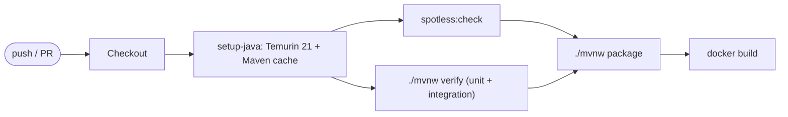

# Operations

## Configuration

All configuration is environment-driven, bound to a validated
`@ConfigurationProperties` record, and checked at startup; the application
refuses to boot on invalid input rather than failing per request.

Environment variables are referenced through explicit `${...}` placeholders in
`application.yaml`, so the names below are exactly what the process reads.

- `SERVER_PORT` — bind port. Default `8080`.
- `MANAGEMENT_SERVER_PORT` — Actuator and Prometheus port, not published
  externally. Default `9090`.
- `PROXY_API_KEYS` — **required**. Comma-separated keys accepted on inbound
  requests. See
  [06-production-readiness.md](06-production-readiness.md#inbound-authentication).
- `MAX_CONCURRENT_REQUESTS` — default `200`. In-flight request cap; beyond it the
  service returns `503` immediately rather than accumulating request state.
- `RATE_LIMIT_RPS` / `RATE_LIMIT_BURST` — per-key token bucket. Defaults `50`
  and `100`.
- `CONNECT_TIMEOUT` — default `2s`, applied to both upstream pools and distinct
  from the read timeouts below.
- `DO_INFERENCE_API_KEY` — **required**. Bearer token for DigitalOcean
  Serverless Inference.
- `DO_INFERENCE_BASE_URL` — default `https://inference.do-ai.run`. Overridden in
  tests to point at WireMock.
- `PRIMARY_MODEL` — **required**. Model serving customer traffic, e.g.
  `llama3.3-70b-instruct`.
- `CANDIDATE_MODEL` — **required**. Model under evaluation.
- `PRIMARY_TIMEOUT` — default `30s`. Read timeout on the customer path.
- `SHADOW_TIMEOUT` — default `20s`. Read timeout for a candidate call; exceeding
  it counts as `shadow_timeouts`.
- `SHADOW_QUEUE_SIZE` — default `256`. `ArrayBlockingQueue` capacity; the primary
  lever on the shadow memory ceiling.
- `SHADOW_WORKERS` — default `8`. Fixed pool size; the cap on concurrent
  candidate calls.
- `SHADOW_SAMPLE_RATE` — default `1.0`, meaning every request is shadowed, as the
  Objective specifies. Lower it to trade sample size for candidate token spend;
  sampled-out requests are reported as `shadow_sampled_out`, never as
  `shadow_shed`.
- `MAX_REQUEST_BYTES` — default `1048576` (1 MB). Enforced by
  `RequestSizeLimitFilter`; also caps per-job memory.
- `MAX_RESPONSE_BYTES` — default `1048576`. Cap on upstream response reads.
- `SHADOW_BREAKER_FAILURE_RATE` / `SHADOW_BREAKER_WAIT` — candidate circuit
  breaker. Defaults `50` percent over a 20-call window, opening for `60s`.
- `SHUTDOWN_GRACE` — default `15s`. In-flight primary requests finish; the shadow
  queue is discarded rather than drained.
- `LOG_LEVEL` — default `info`. Request and response bodies are never logged at
  this level.

Validation rules: timeouts must be positive, `SHADOW_WORKERS` must be at least 1,
`SHADOW_QUEUE_SIZE` must be at least as large as `SHADOW_WORKERS`,
`SHADOW_SAMPLE_RATE` must be within `0.0`–`1.0`, and both
`DO_INFERENCE_API_KEY` and `PROXY_API_KEYS` must be non-blank. Secrets are
redacted in the startup configuration log.

### Tuning guidance

`SHADOW_QUEUE_SIZE` and `SHADOW_WORKERS` are the two knobs that set both the
memory ceiling and the sampling coverage. Raising them samples more traffic at
the cost of heap and upstream pressure; lowering them sheds more. If
`shadow_shed` is persistently high and the candidate endpoint has headroom, raise
workers first, then queue size. If `shadow_errors` is dominated by `429`, lower
workers — the fix is less concurrency, not more retries. Neither knob affects
primary latency.

## Local development

No Maven install is required; the wrapper bootstraps it.

```bash
export DO_INFERENCE_API_KEY=...
export PRIMARY_MODEL=llama3.3-70b-instruct
export CANDIDATE_MODEL=openai-gpt-oss-120b

./mvnw spring-boot:run
```

To run against the WireMock stub instead of the real endpoint — which is how the
load-shed, timeout, and mismatch behaviour is demonstrated without spending
tokens — use `docker compose up`, described in
[05-service-topology.md](05-service-topology.md#docker-topology).

```bash
curl -s localhost:8080/v1/chat \
  -H 'Authorization: Bearer $PROXY_API_KEY' \
  -H 'Content-Type: application/json' \
  -d '{"messages":[{"role":"user","content":"Reply with {\"action\":\"refund\"}"}]}'

curl -s localhost:8080/metric -H "Authorization: Bearer $PROXY_API_KEY" | jq
```

Other useful commands: `./mvnw verify` for the full test suite, `./mvnw spotless:apply`
to format.

## CI/CD

GitHub Actions at `.github/workflows/ci.yml`, triggered on push and pull request.



Gates: the format check and the full `verify` phase must pass before packaging.
The image build runs on every branch to catch Dockerfile breakage early;
publishing is limited to the default branch. Maven dependency caching is handled
by `actions/setup-java` with `cache: maven`.

The image is then scanned with Trivy and an SBOM is attached, and the load test
that proves the latency-isolation claim runs nightly rather than per pull
request. Both are specified in
[06-production-readiness.md](06-production-readiness.md#supply-chain-and-ci-hardening).

## Container

Multi-stage `Dockerfile`. The build stage runs `./mvnw dependency:go-offline`
before copying sources, so dependency resolution is cached independently of code
changes; the runtime stage is `eclipse-temurin:21-jre` running as a non-root
user, exposing the configured port, with a healthcheck against
`/actuator/health`.

Set `-XX:MaxRAMPercentage=75` and let the JVM size the heap from the container
limit rather than hard-coding `-Xmx`. Because the shadow subsystem has a fixed
ceiling, sizing is predictable: set the container limit above the computed
ceiling from
[01-architecture.md](01-architecture.md#how-this-bounds-the-memory-footprint)
plus normal JVM overhead (metaspace, code cache, thread stacks).

## Observability

`GET /metric` is the primary surface and is intentionally cheap to scrape.
Useful derived signals:

- `shadow_shed / total_requests` — sampling loss; rising means burst pressure.
- `exact_match_rate` — the actual product question: how closely the candidate
  tracks the primary.
- `shadow_timeouts / shadow_completed` — candidate latency health.
- `queue_depth / queue_capacity` — saturation, and an early warning before
  shedding starts.

Structured JSON logging via SLF4J with request id, model, upstream status, and
duration. Shadow evaluation logs at debug level to avoid one log line per
background job in production. A shed job is not an error and must not be logged
as one. `/actuator/health` covers liveness and readiness probes.

## Runbook

- **`exact_match_rate` drops sharply** — check `invalid_json_candidate` first; a
  prompt or model change that breaks JSON formatting looks identical to a quality
  regression in the headline number until you split those counters.
- **`shadow_shed` climbing** — expected under burst. Confirm primary latency is
  unaffected, then decide whether to raise capacity or accept reduced sampling.
- **`shadow_timeouts` climbing** — the candidate is degraded. This has no
  customer impact by design; treat it as an evaluation-quality issue.
- **Primary `502`/`504`** — customer-visible. Check upstream status and the API
  key before anything shadow-related.
- **Heap growth** — should be impossible on the shadow path given the fixed
  bounds. Confirm the executor really has an `ArrayBlockingQueue` and that
  `MAX_REQUEST_BYTES` is enforced, then investigate the primary path.
