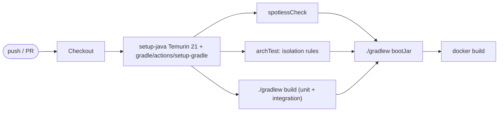

# Operations

## Configuration

All configuration is environment-driven, bound to a validated
`@ConfigurationProperties` record, and checked at startup; the application
refuses to boot on invalid input rather than failing per request.

Environment variables are referenced through explicit `${...}` placeholders in
`application.yaml`, so the names below are exactly what the process reads.

- `SERVER_PORT` — bind port. Default `8080`.
- `MANAGEMENT_SERVER_PORT` — Actuator and Prometheus port, not published
  externally. Default `9090`.
- `MAX_CONCURRENT_REQUESTS` — default `128`, derived below rather than chosen.
  In-flight request cap; beyond it the service returns `503` immediately rather
  than accumulating request state.
- `CONNECT_TIMEOUT` — default `2s`, applied to both upstream pools and distinct
  from the read timeouts below.
- `DO_INFERENCE_API_KEY` — **required**. Bearer token for DigitalOcean
  Serverless Inference.
- `DO_INFERENCE_BASE_URL` — default `https://inference.do-ai.run`. Overridden in
  tests to point at WireMock.
- `PRIMARY_MODEL` — **required**. Model serving customer traffic, e.g.
  `llama3.3-70b-instruct`.
- `CANDIDATE_MODEL` — **required**. Model under evaluation.
- `UPSTREAM_RPM_LIMIT` — default `250`, matching DigitalOcean's documented
  default. Serverless tiers differ (Tier 1 is 120 RPM, Tier 5 is 4,500), so this
  is configuration, and the pool sizes below are derived from it.
- `CANDIDATE_QUOTA_SHARE` — default `0.4`. Fraction of the upstream request
  budget the shadow path may consume. The primary is never client-side throttled.
- `PRIMARY_TIMEOUT` — default `30s`. Read timeout on the customer path.
- `SHADOW_TIMEOUT` — default `20s`. Read timeout for a candidate call; exceeding
  it counts as `shadow_timeouts`.
- `SHADOW_QUEUE_SIZE` — default `32`. `ArrayBlockingQueue` capacity. Deliberately
  shallow, and derived below rather than chosen; see
  [01-architecture.md](01-architecture.md#load-shedding-and-why-it-is-not-just-drop-when-full).
- `SHADOW_WORKERS` — default `32`. Fixed pool size; the cap on concurrent
  candidate calls.
- `SHADOW_BUDGET_BYTES` — default `8388608` (8 MiB). Hard byte ceiling on
  admitted-but-unfinished shadow work, reserved with a compare-and-set loop.
- `SHADOW_TASK_TTL` — default `30s`. Jobs older than this are dropped at dequeue
  as `stale_in_queue` rather than spending upstream quota on a stale sample.
- `SHADOW_SAMPLE_RATE` — default `1.0`, meaning every request is eligible, as the
  Objective specifies. This is the operator-set ceiling; the adaptive admission
  probability in [01-architecture.md](01-architecture.md#load-shedding-and-why-it-is-not-just-drop-when-full)
  may drop below it under burst, and the two are reported separately.
- `SHADOW_CONTROL_ARM_RATE` — default `0.01`. Fraction of shadow jobs sent to the
  **primary** model instead of the candidate, establishing the A/A noise floor.
- `MAX_REQUEST_BYTES` — default `131072` (128 KiB). Enforced by
  `RequestSizeLimitFilter`; also caps a job's byte reservation.
- `MAX_RESPONSE_BYTES` — default `262144` (256 KiB). Cap on upstream response
  reads.
- `MAX_EVAL_CONTENT_BYTES` — default `32768` (32 KiB). Cap on the assistant
  content retained for comparison; an `{"action": "..."}` payload is under 1 KiB,
  so this is ample headroom.
- `SHADOW_BREAKER_FAILURE_RATE` / `SHADOW_BREAKER_WAIT` — candidate circuit
  breaker. Defaults `50` percent over a 20-call window, opening for `60s`.
- `SHUTDOWN_GRACE` — default `15s`. In-flight primary requests finish; the shadow
  queue is discarded rather than drained.
- `LOG_LEVEL` — default `info`. Request and response bodies are never logged at
  this level.

Validation rules: timeouts must be positive, `SHADOW_WORKERS` must be at least 1,
`SHADOW_QUEUE_SIZE` must be at least as large as `SHADOW_WORKERS`,
`SHADOW_SAMPLE_RATE` must be within `0.0`–`1.0`, and `DO_INFERENCE_API_KEY` must
be non-blank. Secrets are redacted in the startup configuration log.

### Deriving the concurrency constants

These defaults are derived, not guessed, and should be re-derived rather than
nudged when the upstream limit changes.

The binding constraint is upstream request quota, not CPU. At the documented
default of 250 requests/minute shared across both models, total sustainable
throughput is about 4.2 requests/second. Little's law (`L = λ × W`) then gives
the two pool sizes:

```
MAX_CONCURRENT_REQUESTS  = 4.2 req/s  x 30s primary timeout  ~= 126  -> 128
candidate share          = 4.2 req/s  x 0.4                   ~= 1.7 req/s
SHADOW_WORKERS           = 1.7 req/s  x 20s shadow timeout    ~=  34  ->  32
```

Queue depth follows from drain rate and TTL, not from a round number. Anything
deeper than `drain_rate × SHADOW_TASK_TTL` is guaranteed to hold jobs that will
expire before they are ever processed, which is memory spent to produce nothing.
That ceiling and the `SHADOW_QUEUE_SIZE >= SHADOW_WORKERS` validation rule bracket
the depth from both sides:

```
floor (validation)  = SHADOW_WORKERS                          =  32
ceiling (usefulness)= 1.7 jobs/s x 30s SHADOW_TASK_TTL        ~=  51
SHADOW_QUEUE_SIZE   = 32, draining in ~19s, comfortably inside the TTL
```

The TTL is set to `30s` rather than something tighter so the ceiling clears the
floor at all: at a `15s` TTL the ceiling would be about 26 jobs, below the
32-worker floor, and every legal queue depth would then be one that admits jobs
destined to expire unprocessed.

Two consequences worth internalising. First, **one replica saturates the entire
account quota**, so additional replicas buy availability, not throughput. Second,
the candidate is throttled and the primary never is: spending customer-facing
capacity to feed a measurement system would invert the priorities.

### Tuning guidance

`SHADOW_WORKERS` and `CANDIDATE_QUOTA_SHARE` set sampling coverage; the queue and
byte budget set the memory ceiling. If `coverage_pct` is low while the candidate
endpoint has headroom, raise the quota share and re-derive workers. If
`shadow_errors` is dominated by `429`, lower the quota share — the fix is less
concurrency, not more retries, and sustained failures will trip the breaker
anyway. None of these knobs affects primary latency.

Watch `shed_by_reason` rather than the shed total: `sampled_out` means the
adaptive governor is working as designed, `queue_full` and `byte_budget` mean the
hard gates are binding, and `stale_in_queue` means the queue is deeper than the
drain rate justifies.

## Local development

No Gradle install is required; the wrapper bootstraps a pinned, checksum-verified
distribution.

```bash
export DO_INFERENCE_API_KEY=...
export PRIMARY_MODEL=llama3.3-70b-instruct
export CANDIDATE_MODEL=openai-gpt-oss-120b

./gradlew bootRun
```

To run against the WireMock stub instead of the real endpoint — which is how the
load-shed, timeout, and mismatch behaviour is demonstrated without spending
tokens — use `docker compose up`, described in
[05-service-topology.md](05-service-topology.md#docker-topology).

```bash
curl -s localhost:8080/v1/chat \
  -H 'Content-Type: application/json' \
  -d '{"messages":[{"role":"user","content":"Reply with {\"action\":\"refund\"}"}]}'

curl -s localhost:8080/metric | jq
```

Other useful commands: `./gradlew build` for the full check-and-assemble cycle,
`./gradlew test integrationTest` for the suites individually, and
`./gradlew spotlessApply` to format. The build enables the configuration cache
and Gradle's build cache, so incremental runs stay fast.

## CI/CD

GitHub Actions at `.github/workflows/ci.yml`, triggered on push and pull request.



Gates: formatting, the ArchUnit isolation rules, and the full test suite must all
pass before the jar is assembled. The image build runs on every branch to catch
Dockerfile breakage early; publishing is limited to the default branch.
Dependency and build-output caching is handled by `gradle/actions/setup-gradle`,
with the configuration cache enabled and dependency verification checked against
`gradle/verification-metadata.xml`.

The image is then scanned with Trivy and an SBOM is attached, and the load test
that proves the latency-isolation claim runs nightly rather than per pull
request. Both are specified in
[06-production-readiness.md](06-production-readiness.md#supply-chain-and-ci-hardening).

## Container

Multi-stage `Dockerfile`. The build stage resolves dependencies before copying
sources so resolution is cached independently of code changes, then the Spring
Boot **layered jar** is extracted so dependencies, loader, and application
classes land in separate image layers — a code-only change then rebuilds a few
hundred kilobytes instead of the whole fat jar. The runtime stage is
`eclipse-temurin:21-jre` pinned by digest, running as a non-root user, exposing
the configured port, with a healthcheck against `/actuator/health`.

Set `-XX:MaxRAMPercentage=70` and let the JVM size the heap from the container
limit rather than hard-coding `-Xmx`. The bounded terms in
[01-architecture.md](01-architecture.md#how-this-bounds-the-memory-footprint)
guarantee that load cannot push the application past its ceiling, but on the JVM
they do not determine the container size — baseline footprint does. Use the
768 MB figure derived in
[06-production-readiness.md](06-production-readiness.md#capacity-and-deployment).

## Observability

`GET /metric` is the primary surface and is intentionally cheap to scrape.
Useful derived signals:

- `shadow_shed / total_requests` — sampling loss; rising means burst pressure.
- `exact_match_rate` — the actual product question: how closely the candidate
  tracks the primary.
- `shadow_timeouts / shadow_completed` — candidate latency health.
- `queue_depth / queue_capacity` — saturation, and an early warning before
  shedding starts.

Structured JSON logging via SLF4J with request id, model, upstream status, and
duration. Shadow evaluation logs at debug level to avoid one log line per
background job in production. A shed job is not an error and must not be logged
as one. `/actuator/health` covers liveness and readiness probes.

## Runbook

- **`exact_match_rate` drops sharply** — check `invalid_json_candidate` first; a
  prompt or model change that breaks JSON formatting looks identical to a quality
  regression in the headline number until you split those counters.
- **`shadow_shed` climbing** — expected under burst. Confirm primary latency is
  unaffected, then decide whether to raise capacity or accept reduced sampling.
- **`shadow_timeouts` climbing** — the candidate is degraded. This has no
  customer impact by design; treat it as an evaluation-quality issue.
- **Primary `502`/`504`** — customer-visible. Check upstream status and the API
  key before anything shadow-related.
- **Heap growth** — should be impossible on the shadow path given the fixed
  bounds. Confirm the executor really has an `ArrayBlockingQueue` and that
  `MAX_REQUEST_BYTES` is enforced, then investigate the primary path.
