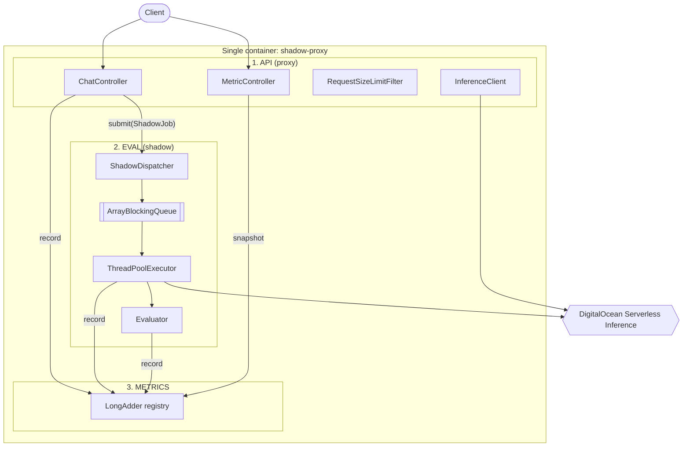

# Service Topology: One Service, Three Frozen Components

## Decision

**One deployable service, one container image, three fixed internal components.**

The API proxy, the shadow evaluation pipeline, and the metrics registry are three
components with frozen contracts, compiled into a single Spring Boot application
and shipped as a single Docker image.

This section is a decision record. The component boundaries and the interfaces in
[Frozen contracts](#frozen-contracts) do not change during implementation.

## Why not three services

The shadow-traffic literature does generally advise separating the shadow service
from the production service
([scalablesystem.dev](https://scalablesystem.dev/system-design/build-a-shadow-traffic--dark-launch-system),
[techinterview LLD](https://www.techinterview.org/post/3233470067/lld-shadow-traffic/)).
Reading that advice carefully is what settles the question, because the standard
pattern has four roles and we only build two of them.

- **Mirror / capture plane** — duplicates the request. In every reference
  implementation this lives *inside* the gateway or proxy process.
- **Shadow target** — the candidate implementation under test. The advice to
  "separate the shadow service" refers to *this* role.
- **Comparison plane** — diffs the two outputs.
- **Analysis plane** — stores pairs, aggregates, and reports.

For us the shadow target is **DigitalOcean's candidate model endpoint**. It is
already a separate service, on separate infrastructure, operated by someone else.
The isolation the literature asks for is not something we need to build — we get
it for free the moment we point at a different `model` value. Splitting our own
process into three would not add one bit of isolation to the thing that actually
needs isolating.

That leaves the mirror plane and the comparison plane, and here the precedent is
unambiguous. Envoy and Istio implement request mirroring **in-process**,
fire-and-forget, on a separate connection pool, with the shadow response
discarded, and it is explicitly documented as adding zero latency to the
client-visible path
([Envoy route mirroring](https://www.envoyproxy.io/docs/envoy/latest/start/sandboxes/route-mirror),
[Istio mirroring](https://istio.io/latest/docs/tasks/traffic-management/mirroring/)).
That is the most battle-tested implementation of this exact pattern in existence,
and it is a single process. The same low-level design that recommends separation
also specifies the queue as a "Kafka topic **or in-process ring buffer**" drained
by "a sidecar **or worker thread**" — in-process is a sanctioned option in the
very source that recommends splitting.

The reason the literature pushes the comparison plane out of band is **evaluation
cost**: semantic similarity, LLM-as-judge, and embedding comparisons are
expensive, so they get batched offline. Our Objective mandates a *deterministic
heuristic* — parse two JSON documents, compare one string field. That is
microseconds of CPU on payloads we already have in memory. The entire economic
argument for separating the comparison plane evaporates.

### The argument that splitting actively hurts here

The Objective's hardest requirement is that shadow work "must never delay or
impact primary response." In one process, the hand-off is
`executor.execute(job)` against a bounded queue: a few hundred nanoseconds, and
it cannot fail in a way that reaches the customer.

Split into services, the API must hand the job to eval over the network. That
call is now adjacent to the request path, and it has its own latency, its own
failure modes, and its own backpressure. To keep the guarantee you would buffer
locally and drain asynchronously — which means implementing the bounded in-memory
queue **anyway**, and then adding a broker behind it. Strictly more machinery for
an identical guarantee, with a new unbounded backlog (broker retention) to
configure in a design whose stated goal is bounding memory.

Separating metrics is weaker still. `/metric` must be real-time and its counters
are incremented by the same code paths that would have to publish them over a
network. In-process counters are exact and free; remote counters are eventually
consistent and can fail. There is no version of this where the split is better at
our scale.

### What we give up, stated honestly

- **Independent scaling.** Not useful here: evaluation is a JSON parse, and the
  expensive part of the shadow path is waiting on the candidate model, which is
  I/O already bounded by `SHADOW_WORKERS`.
- **Independent deploys.** Changing the heuristic redeploys the proxy. Rolling
  deploys make this a non-issue at this size.
- **Blast radius.** An eval bug can in principle harm the proxy. This is the one
  real cost, and it is precisely what the bounded queue, the fixed pool, the
  per-task `try/catch (Throwable)`, and the response-size caps in
  [01-architecture.md](01-architecture.md) exist to contain.
- **Durability across restarts.** In-flight shadow jobs are lost on restart. This
  is explicitly acceptable: shadow traffic is best-effort, we already shed it
  under load on purpose, and the referenced LLD says the same — on shadow failure
  "record a SHADOW_ERROR result but do not re-enqueue."

## Component map



The dependency rule is one-directional and acyclic: **API depends on EVAL and
METRICS; EVAL depends on METRICS; METRICS depends on nothing.** EVAL never calls
back into API. Any pull request that introduces an edge against this direction is
wrong by definition.

## The three components

### 1. API (proxy) — `proxy/`, `inference/`, `web/`

Owns the customer-facing contract and nothing else.

- Serves `POST /v1/chat` and `GET /metric`.
- Enforces `MAX_REQUEST_BYTES`, content type, and the `stream: true` rejection.
- Calls the primary model and relays status and body verbatim.
- Hands a `ShadowJob` to EVAL **after** the response is written, and only when
  the primary call succeeded.
- Reads a snapshot from METRICS to serve `/metric`.

Does not: know what evaluation means, interpret the candidate, or touch the
shadow queue directly.

### 2. EVAL (shadow) — `shadow/`, `eval/`

Owns everything asynchronous, and owns the load-shed policy.

- Accepts jobs through the bounded queue, shedding when full.
- Runs the fixed worker pool and calls the candidate model.
- Applies the deterministic heuristic and reports outcomes to METRICS.

Does not: touch `HttpServletRequest` or any request-scoped state, throw into the
caller, block the submitting thread, or retry.

### 3. METRICS — `metrics/`

Owns all counters and the snapshot shape.

- Accepts increments from API and EVAL through a write-only interface.
- Produces an immutable snapshot with the rate computed at read time.

Does not: perform I/O, call the other components, or block.

## Frozen contracts

These signatures are fixed for the duration of implementation. Behaviour behind
them may be optimised; the shapes may not drift.

```java
// ---- API -> EVAL : the entire surface between them ----
public interface ShadowDispatcher {
    /** Never blocks. Never throws. Sheds when the queue is full. */
    void submit(ShadowJob job);
}

public record ShadowJob(
    String requestId,
    byte[] requestBody,          // defensive copy, immutable by convention
    byte[] primaryResponseBody,
    Instant capturedAt
) {}

// ---- inside EVAL ----
public interface Evaluator {
    /** Pure. No I/O, no logging, no state. */
    EvalResult compare(byte[] primaryBody, byte[] candidateBody);
}

public enum EvalResult {
    MATCH, MISMATCH, INVALID_PRIMARY, INVALID_CANDIDATE, INVALID_BOTH, MISSING_ACTION
}

public enum ShadowOutcome { OK, ERROR, TIMEOUT, SHED }

// ---- API, EVAL -> METRICS : write side only ----
public interface MetricsRecorder {
    void recordRequest();
    void recordShadowEnqueued();
    void recordShadowShed();
    void recordShadowCompleted(ShadowOutcome outcome);
    void recordEvaluation(EvalResult result);
}

// ---- METRICS -> API : read side only ----
public interface MetricsReader {
    MetricsSnapshot snapshot();
}
```

Splitting `MetricsRecorder` from `MetricsReader` is deliberate: EVAL is injected
only with the writer and therefore cannot read or reason about aggregate state,
and `MetricController` is injected only with the reader. The compiler enforces
the direction of the dependency rule rather than a code review having to.

The `/metric` JSON payload is likewise frozen at the field list in
[02-api-contract.md](02-api-contract.md).

## Migration seam, if the decision ever needs revisiting

Because `ShadowDispatcher` is the single edge between API and EVAL, extracting
EVAL into its own service later means writing one alternative implementation that
publishes to a broker instead of a local queue. No controller, evaluator, or
metric code changes. The seam costs nothing today and preserves the option.

We would revisit if any of these became true, and none are today:

- Evaluation becomes expensive (LLM-as-judge, embeddings), making CPU contention
  with the request path real.
- Evaluation results need durable storage and replay rather than live counters.
- Shadow throughput needs to scale on a different axis from customer traffic.
- Multiple upstream services need to share one evaluation pipeline.

## Docker topology

**One application image.** Multi-stage build, dependency layer cached separately
from application classes, `eclipse-temurin:21-jre` runtime, non-root user,
healthcheck against `/actuator/health`, `-XX:MaxRAMPercentage=75` so the JVM
sizes its heap from the container limit.

**`docker-compose.yaml` for local development only**, running two containers:

- `proxy` — the application, built from the local Dockerfile.
- `mock-inference` — a WireMock container standing in for
  `https://inference.do-ai.run`, with configurable latency and failure injection
  so the load-shed and timeout behaviour can be demonstrated without spending
  tokens or holding a real API key.

`DO_INFERENCE_BASE_URL` points at `mock-inference` in compose and at the real
endpoint in production. That single variable is the only difference between the
two environments, which keeps the local demo honest.

There is no broker, no database, and no sidecar in either environment.

## Sampling

The Objective specifies shadowing "the exact same traffic," so the default is
100%. We add `SHADOW_SAMPLE_RATE` (default `1.0`) as a deliberate cost control,
since the literature converges on 10–25% sampling being sufficient for
statistical confidence on high-volume routes. At the default it is a no-op and
the Objective is satisfied exactly; lowering it is a knob an operator can reach
for when candidate token spend matters more than sample size. Sampling is applied
before the queue, and sampled-out requests are counted separately from shed ones
so the two causes of missing evaluations are never confused.
